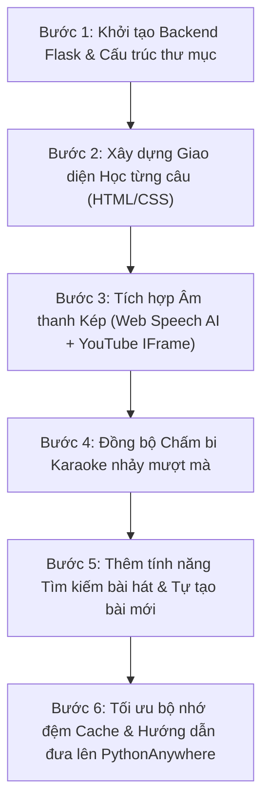

# KẾ HOẠCH VÀ KIẾN TRÚC PHÁT TRIỂN WEB HỌC TIẾNG TRUNG QUA BÀI HÁT
*(Phiên bản Kiến trúc Hybrid: Zero-Server-Audio & Nhúng YouTube Thông Minh)*

---

## 1. TỔNG QUAN HỆ THỐNG
Dự án là ứng dụng web hỗ trợ người học tiếng Trung thông qua lời các bài hát yêu thích:
- **Tập trung vào phát âm và nhịp điệu:** Người học cần nghe rõ cách phát âm từng từ, đọc đúng ngữ điệu và ngắt nghỉ theo câu hát mà không bị phân tâm bởi nhạc nền, đồng thời có thể nghe ca sĩ hát mẫu đúng giai điệu bài hát gốc.
- **Mô hình Âm thanh kép (Dual-Audio) không lưu MP3 trên server:**
  1. **Giọng đọc AI (Web Speech API):** Phát âm chuẩn từng từ, từng câu, chỉnh tốc độ đọc (0.5x - 1.0x), không tốn mạng.
  2. **Giọng ca sĩ gốc (YouTube IFrame Player API):** Nhúng video YouTube chính thức, bấm vào câu nào phát đúng vài giây ca sĩ hát câu đó rồi tự động dừng lại.
- **Tiết kiệm dữ liệu tuyệt đối:** Máy chủ PythonAnywhere lưu trữ 0 MB file nhạc (chỉ lưu các file JSON văn bản nặng 5 - 10 KB). Bộ nhớ 512MB miễn phí có thể chứa hơn **50.000 bài hát**!
- **Tự động 100%:** Người dùng chỉ cần gõ tên bài hát (ví dụ: *"Quan sơn tửu"* hoặc *"关山酒"*), web tự động thu thập lời, sinh Pinyin, dịch nghĩa và dựng giao diện trong tích tắc.

---

## 2. BỐ CỤC GIAO DIỆN HỌC TẬP (MỖI CÂU HÁT)

```
+-------------------------------------------------------------+
|  [Pinyin]    yī      hú     zhuó     jiǔ     wàng   qióng ...|
|  [Hán tự]    一       壶      浊       酒      望      穹  ...|
|  [Nghĩa]     một     bầu     đục      rượu    nhìn   trời ...|
+-------------------------------------------------------------+
|  [Ghi chú]   Chữ "浊" (zhuó) thanh 2, âm 'zh' uốn đầu lưỡi. |
+-------------------------------------------------------------+
|  [Loa AI] 🔊  [Ca sĩ] 🎵   [Tốc độ] 0.75x ▾                 |
|  [Chấm bi]    ●                                             |
|  [Cả câu]    一壶浊酒望穹庐                                  |
|  [Dịch câu]  Cầm một bầu rượu đục, nhìn ngắm núi sông ngút ngàn |
+-------------------------------------------------------------+
```

1. **Khối từ vựng chi tiết:**
   - **Hán tự:** Hiển thị to, rõ nét, phân tách từng chữ.
   - **Pinyin:** Nằm ngay trên đầu chữ Hán kèm thanh điệu chuẩn.
   - **Nghĩa tiếng Việt:** Nằm ngay dưới từng chữ để hiểu cấu tạo từ.
   - **Phát âm từ lẻ:** Bấm vào bất kỳ từ nào để nghe đọc riêng từ đó (0 KB mạng).
2. **Khối ghi chú & hướng dẫn:**
   - Mẹo phát âm (uốn lưỡi, bật hơi, biến điệu thanh điệu) và ngữ pháp câu.
3. **Khối Điều khiển Âm thanh Kép & Chấm bi:**
   - 🔊 **Loa AI:** Đọc chậm rãi, phát âm từng chữ rõ ràng, thanh điệu chuẩn mực.
   - 🎵 **Ca sĩ hát:** YouTube phát đúng phân đoạn thời gian của câu này từ video gốc (ví dụ: từ giây `14.5` đến `18.2`) rồi tự động dừng.
   - **Chấm bi Karaoke:** Chấm bi nhảy nhịp nhàng qua từng chữ Hán theo thời gian thực (hỗ trợ cả lúc AI đọc và lúc Ca sĩ hát).

---

## 3. CẤU TRÚC DỮ LIỆU BÀI HỌC (JSON SIÊU NHẸ)

Mỗi bài hát được lưu dưới dạng file JSON chỉ nặng khoảng vài KB:

```json
{
  "id": "quan_son_tuu",
  "title": "Quan sơn tửu (关山酒)",
  "artist": "Tiểu Hồn (小魂)",
  "youtube_id": "3wK_lq1VbXk",
  "sentences": [
    {
      "id": 1,
      "meaning": "Cầm một bầu rượu đục, nhìn ngắm núi sông ngút ngàn",
      "pinyin_full": "yī hú zhuó jiǔ wàng qióng lú",
      "start": 14.5,
      "end": 18.2,
      "words": [
        { "hanzi": "一", "pinyin": "yī", "meaning": "một", "offset": 0.0 },
        { "hanzi": "壶", "pinyin": "hú", "meaning": "bầu/bình", "offset": 0.5 },
        { "hanzi": "浊", "pinyin": "zhuó", "meaning": "đục", "offset": 1.0 },
        { "hanzi": "酒", "pinyin": "jiǔ", "meaning": "rượu", "offset": 1.5 },
        { "hanzi": "望", "pinyin": "wàng", "meaning": "nhìn", "offset": 2.2 },
        { "hanzi": "穹", "pinyin": "qióng", "meaning": "vòm trời", "offset": 2.8 },
        { "hanzi": "庐", "pinyin": "lú", "meaning": "nhà lều/núi sông", "offset": 3.4 }
      ],
      "note": "Chữ '浊' (zhuó) mang thanh 2, âm 'zh' uốn đầu lưỡi chạm ngạc cứng."
    }
  ]
}
```

---

## 4. QUY TRÌNH KỸ THUẬT NHÚNG YOUTUBE KHÔNG LƯU MP3

1. **Khởi tạo YouTube Player:**
   - Sử dụng thẻ nhúng chính thức `https://www.youtube.com/iframe_api`.
   - Tạo đối tượng `player = new YT.Player('youtube-player', { videoId: ... })`.
2. **Cơ chế Phát từng câu (Snippet Playback):**
   ```javascript
   function playSingerSnippet(startTime, endTime) {
       player.seekTo(startTime, true);
       player.playVideo();
       
       let durationMs = (endTime - startTime) * 1000;
       clearTimeout(window.snippetTimer);
       window.snippetTimer = setTimeout(() => {
           player.pauseVideo();
       }, durationMs);
   }
   ```
3. **Đồng bộ chấm bi khi Ca sĩ hát:**
   - Dùng `requestAnimationFrame` hoặc `setInterval` lấy `player.getCurrentTime()`.
   - Tính toán từ nào trong câu tương ứng với thời gian hiện tại và kích hoạt hiệu ứng chấm bi nhảy qua chữ đó.

---

## 5. LỘ TRÌNH THỰC HIỆN CODE


